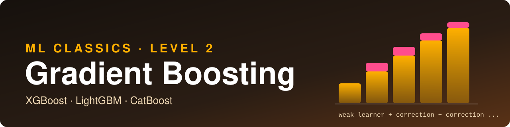
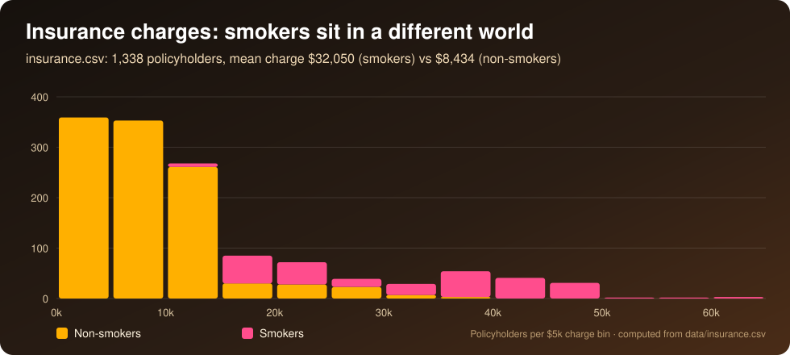
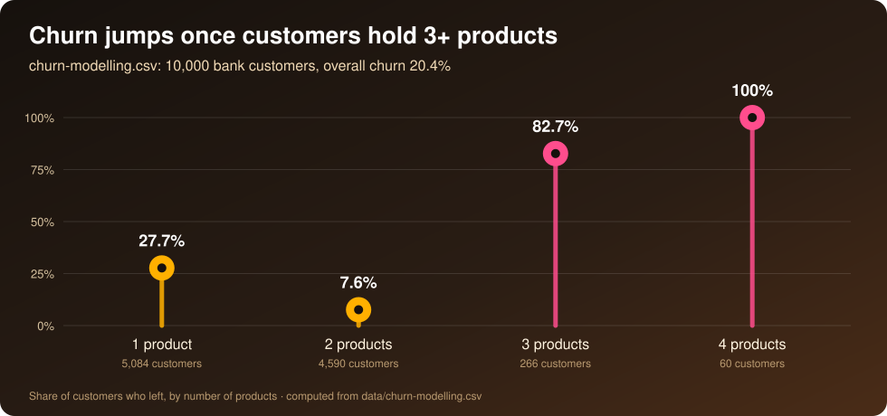

<p align="center">
  <a href="https://xgboost.readthedocs.io/"></a>
  <a href="https://lightgbm.readthedocs.io/"></a>
  <a href="https://catboost.ai/"></a>
  <a href="https://scikit-learn.org/"></a>
  <a href="https://jupyter.org/"></a>
  <a href=".github/workflows/notebooks-check.yml"></a>
  
  
</p>

**Which boosting library wins?** Three of them, XGBoost, LightGBM and CatBoost, go through the same workflow on two datasets: a baseline, cross-validation, a hyperparameter search and a tuned model. Seven notebooks, one scoreboard, and the answer is closer than you might expect.

> *"Same split, same metrics, three libraries: 7 notebooks, 1,229 lines of annotated Python."*

---

## Course map

| # | Section | Notebooks | What you work on |
|:-:|---------|:---------:|------------------|
| 00 | [Quickstart](00-quickstart/) 🎯 | 1 script | Project overview |
| 01 | [Advanced Regression](01-advanced-regression/) 📈 | 3 | XGBoost, LightGBM, CatBoost on insurance charges |
| 02 | [Advanced Classification](02-advanced-classification/) 🎯 | 3 | The same three on bank-customer churn |
| 03 | [Model Comparison](03-model-comparison/) ⚖️ | 1 | Error, R² and training time side by side |

---

## Learning path

```
 Baseline ──► Cross-validation ──► Hyperparameter search ──► Tuned model ──► Compare
  one model     5-fold score        GridSearchCV / random      retrain on       MAE · RMSE · R²
  vs forest     is it stable?       best depth, rate, trees    the best params  training time
```

Every notebook walks through these five steps, so once you have read one you can read the others quickly and focus on what is different about each library.

---

## Two datasets, two stories

Both charts are computed from the CSV files in [`data/`](data/).



The insurance data (1,338 policyholders) is why boosting shines on tabular data: charges are heavily right-skewed and one feature, `smoker`, separates two very different groups. A tree-based model can split on it directly.



The churn data (10,000 bank customers, 20.4% churned) is imbalanced, so accuracy alone flatters a model. The classification notebooks therefore also report F1, precision, recall and ROC-AUC. Note how few customers hold 3 or 4 products (266 and 60): a rate of 100% there rests on 60 people.

---

## Scoreboard

Numbers saved in the notebooks' own outputs, not re-run for this README.

**Regression: insurance charges** (`03-model-comparison/01-regression-model-comparison`, same train/test split for all three)

| Library | MAE | RMSE | R² | Training time |
|---|--:|--:|--:|--:|
| **XGBoost** | 2,466 | 4,259 | 0.8832 | 0.20 s |
| **LightGBM** | 2,472 | 4,283 | 0.8818 | 0.12 s |
| **CatBoost** | 2,495 | 4,310 | 0.8803 | 0.06 s |

The three libraries finish within 0.003 R² of each other, while their training times differ by up to 3× (0.06 s to 0.20 s here), so on this dataset the choice is about speed and convenience more than accuracy.

**Classification: customer churn** (`02-advanced-classification/03-catboost-classifier`)

| Best model | Accuracy | Precision | Recall | F1 | ROC-AUC |
|---|--:|--:|--:|--:|--:|
| **VotingClassifier** | 0.8705 | 0.8033 | 0.4816 | 0.6022 | 0.7257 |

Accuracy looks great at 0.8705, but recall of 0.4816 means more than half of the customers who leave are still missed. That gap is the point of the classification section. (For reference, the plain XGBoost classifier reaches a test accuracy of 0.8510 in `02-advanced-classification/01-xgboost-classifier`.)

<details>
<summary>📈 Sample from <code>03-model-comparison/01-regression-model-comparison.ipynb</code></summary>

```python
# 📌 Define machine learning models for regression
models = {
    "CatBoost": CatBoostRegressor(iterations=500, learning_rate=0.05, depth=6, l2_leaf_reg=3, loss_function='RMSE', verbose=0, random_state=42),
    "XGBoost": XGBRegressor(n_estimators=500, learning_rate=0.05, max_depth=6, reg_lambda=1, objective='reg:squarederror', random_state=42),
    "LightGBM": LGBMRegressor(n_estimators=500, learning_rate=0.05, max_depth=6, reg_lambda=1, objective='regression', random_state=42)
}
```

</details>

---

## Notebook tour

<details>
<summary>📈 <b>Section 1 — Advanced Regression</b> (3 notebooks)</summary>

| Notebook | What it covers |
|---|---|
| [`01-xgboost-regressor.ipynb`](01-advanced-regression/01-xgboost-regressor.ipynb) | XGBoost vs Random Forest: before and after hyperparameter tuning |
| [`02-lightgbm-regressor.ipynb`](01-advanced-regression/02-lightgbm-regressor.ipynb) | LightGBM, with XGBoost and Random Forest as references: cross-validation and tuning |
| [`03-catboost-regressor.ipynb`](01-advanced-regression/03-catboost-regressor.ipynb) | CatBoost: grid and randomized hyperparameter search (720 fits), final metrics |

</details>

<details>
<summary>🎯 <b>Section 2 — Advanced Classification</b> (3 notebooks)</summary>

| Notebook | What it covers |
|---|---|
| [`01-xgboost-classifier.ipynb`](02-advanced-classification/01-xgboost-classifier.ipynb) | XGBoost classifier: train/test accuracy, cross-validation, ROC-AUC, tuning |
| [`02-lightgbm-classifier.ipynb`](02-advanced-classification/02-lightgbm-classifier.ipynb) | LightGBM classifier: is the insurance charge above the median? Compared with XGBoost and Random Forest, then tuned |
| [`03-catboost-classifier.ipynb`](02-advanced-classification/03-catboost-classifier.ipynb) | CatBoost classifier and a voting ensemble, final comparison table |

</details>

<details>
<summary>⚖️ <b>Section 3 — Model Comparison</b> (1 notebooks)</summary>

| Notebook | What it covers |
|---|---|
| [`01-regression-model-comparison.ipynb`](03-model-comparison/01-regression-model-comparison.ipynb) | CatBoost vs XGBoost vs LightGBM: MAE, MSE, RMSE, R² and training time |

</details>

---

## Repository layout

```
Ml-Classics-Level2-Boosting/
├── 00-quickstart/                 # project overview script
├── 01-advanced-regression/        # one folder per part,
├── 02-advanced-classification/    #   each with its own README
├── 03-model-comparison/
├── data/                          # insurance.csv, churn-modelling.csv
├── assets/                        # README banner and charts
├── .github/                       # CI
└── requirements.txt
```

**Why a single `main`?** This repo used to keep every part on its own branch, and the datasets on yet another one. Everything now lives on `main`, and the original branch history is preserved in the commit graph.

---

## Quick start

```bash
git clone https://github.com/evgeniimatveev/Ml-Classics-Level2-Boosting.git
cd Ml-Classics-Level2-Boosting
uv venv && uv pip install -r requirements.txt   # or: python -m venv .venv && pip install -r requirements.txt
jupyter lab
```

Open a notebook from its own folder: it reads the data with `../data/...`, which is where Jupyter's working directory points by default.

---

## Continuous integration

Every push and pull request runs [`notebooks-check.yml`](.github/workflows/notebooks-check.yml):

| Check | What it catches |
|-------|-----------------|
| **Validate every `.ipynb`** | Broken or corrupted notebook files |
| **Code-cell syntax** | Syntax errors in any cell |
| **Widget metadata** | Notebooks GitHub would show as "Invalid Notebook" |
| **File-name hygiene** | Spaces in file names |
| **Quickstart script + datasets** | `ml_level2_intro.py` still runs and the CSV files exist |

Notebooks are teaching material, so they are **not** executed on every push. A second workflow, [`notebooks-run.yml`](.github/workflows/notebooks-run.yml), is **manual**: Actions → *Notebook run (manual)* → *Run workflow*. It executes all 7 notebooks top to bottom and writes a pass/fail table to the Job Summary. Last full run: **7 of 7 pass** (a few minutes).

---

## Known limitations

- The notebooks read data with relative paths (`../data/...`). In Google Colab, clone the repo first and open the notebook from the cloned folder.
- Saved outputs come from the original runs, so a fresh run can differ in the last decimals (library versions, random seeds in the searches).
- The CatBoost notebooks start with `!pip install catboost`; with `requirements.txt` installed this line is not needed.
- Hyperparameter searches are real searches: the CatBoost regressor notebook alone contains a 720-fit grid search, so allow a minute or two on a laptop.

---

## Tech stack

`Python` · `XGBoost` · `LightGBM` · `CatBoost` · `scikit-learn` · `pandas` · `SHAP` · `Seaborn` · `Jupyter` · `GitHub Actions`

---

*Built by [Evgenii Matveev](https://github.com/evgeniimatveev) · Data Analyst / Analytics & MLOps Engineer*
